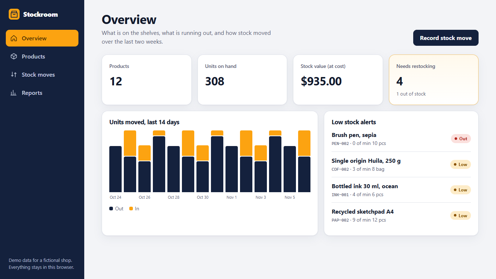
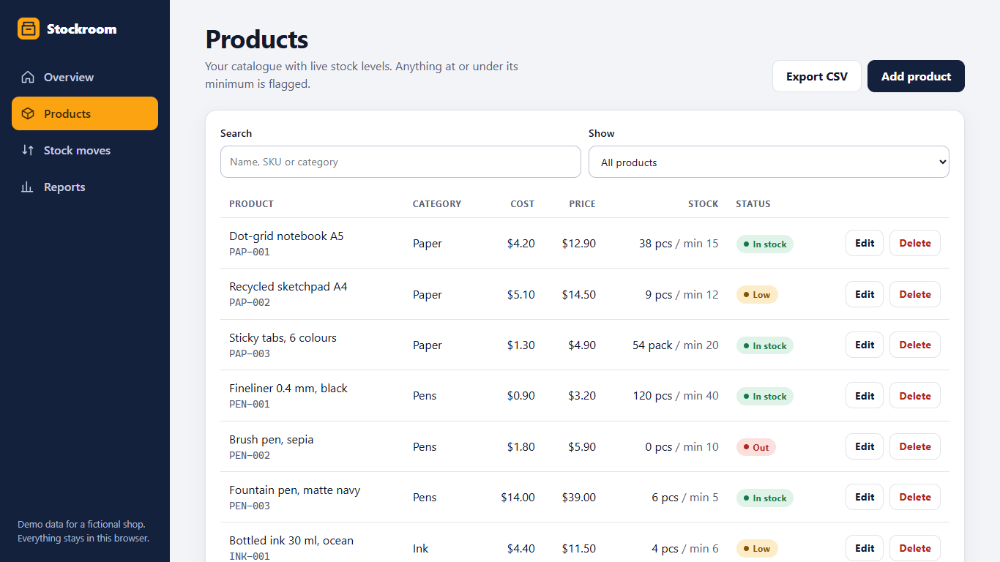
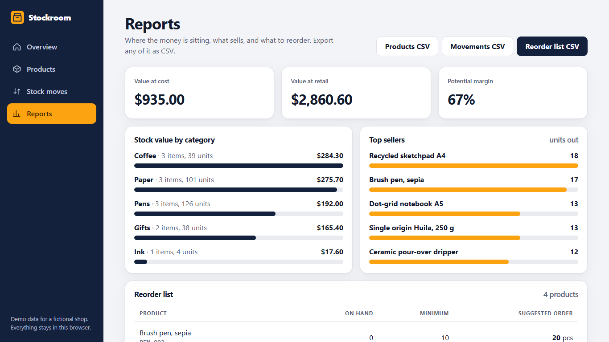
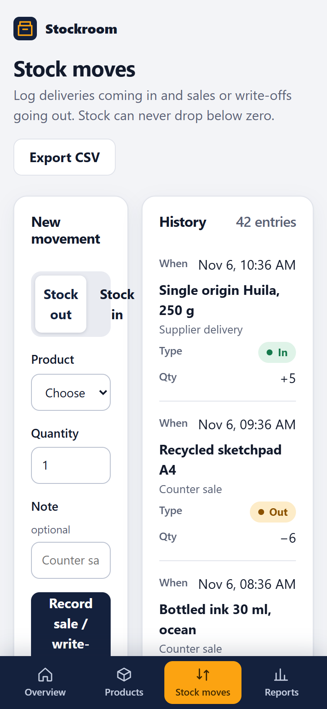

# Stockroom

A small-shop inventory tracker: product catalogue, stock in and out, low-stock alerts, reports and CSV export. The demo runs entirely in the browser, with fictional data for an imaginary paper-and-coffee shop.

**Live demo:** https://alissonlittig.github.io/stockroom-inventory/



## What it does

- **Products**: add, edit and delete items with SKU, category, cost, price, stock and a reorder minimum. Search and filter to low or out-of-stock items.
- **Stock moves**: record deliveries (in) and sales or write-offs (out) with a note. Stock can never go below zero, and the whole history is kept.
- **Alerts**: every product at or under its minimum is flagged on the overview, most urgent first.
- **Reports**: stock value at cost and retail, value by category, top sellers, and a reorder list with suggested quantities.
- **CSV export**: products, movement history and the reorder list. Cells starting with `=`, `+`, `-` or `@` are neutralised so spreadsheets do not run them as formulas.
- **Persistence**: `localStorage`, nothing leaves the browser. "Reset to demo data" restores the sample shop.

| Products | Reports | Mobile (390 px) |
|---|---|---|
|  |  |  |

## Stack

SvelteKit 2 + Svelte 5 (runes), TypeScript, `adapter-static` (prerendered, deployed to GitHub Pages), Vitest, plain CSS. No UI library, no runtime dependencies.

The business rules live in `src/lib/inventory.ts` as pure functions (movements, validation, alerts, reports, CSV) and are covered by unit tests; `src/lib/store.svelte.ts` is the thin reactive/localStorage layer.

## Accessibility and responsiveness

Skip link, semantic landmarks, labelled form controls, native `<dialog>`, visible focus rings, text alternatives for the chart, AA contrast, 44 px touch targets, reduced-motion respected. Tables turn into cards under 640 px and navigation moves to a bottom bar, with no horizontal scrolling at 390 px.

## Run it

```bash
npm install
npm run dev        # http://localhost:5173
npm test           # Vitest
npm run check      # svelte-check
npm run build      # static site in ./build
```

For a sub-path deploy set `BASE_PATH`, for example `BASE_PATH=/stockroom-inventory npm run build`. CI (`.github/workflows/ci.yml`) runs check, tests and build, then deploys to GitHub Pages from `main`.

## License

MIT
